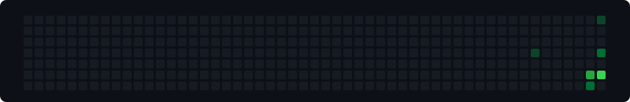

<h1 align="center">Hi, I'm Nico 👋</h1>

Software Engineering student at Heilbronn University 
Currently writing my bachelor thesis on <b>AI pentesting</b> 🛡️🤖 
Hackathons · Security · Games · Building fun and useful stuff

---

## 🧭 About me

| | |
|---|---|
| 🎓 **Studying** | Software Engineering @ Heilbronn University |
| 📝 **Thesis** | AI pentesting |
| 🔭 **Working on** | Unity prototypes, security labs, hackathon projects |
| 🌱 **Learning** | Offensive security, LLM security, RL |
| 🎯 **Looking for** | Hackathons, Master's programme, working student / junior roles |
| 📍 **Location** | Germany |

---

## 🧰 Skills

🌐 Socials · 💻 Languages · 🧱 Web & Backend · 🤖 AI & Machine Learning · 🔐 Security · 🗄️ Databases · 🛠️ DevOps & Tools · ✍️ Editors & OS · 🎮 Games & Creative

<h3>🌐 Socials</h3>

<h3>💻 Languages</h3>

<h3>🧱 Web & Backend</h3>

<h3>🤖 AI & Machine Learning</h3>

<h3>🔐 Security</h3>

<h3>🗄️ Databases</h3>

<h3>🛠️ DevOps & Tools</h3>

<h3>✍️ Editors & OS</h3>

<h3>🎮 Games & Creative</h3>

---

## 🏆 Hackathons & Game Jams

| Date | Event | Location |
|---|---|---|
| 26 Jan – 1 Feb 2026 | **Global Game Jam 2026** (GGJ goes THE LÄND) | Heilbronn |
| 22–23 May 2025 | **Healthcare Hackathon 2025 @ PwC** | Frankfurt |

---

## 📊 GitHub Stats

---

