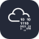

<p align="center">

</p>

<p align="center">

</p>

<p align="center">
<a href="https://www.linkedin.com/in/nico-staudacher/"></a> <a href="https://tryhackme.com/p/Ivo89"></a> <a href="https://www.hackthebox.com/"></a>
</p>

<br />

```console
nico@hhn:~$ whoami
Software Engineering student @ Heilbronn University

nico@hhn:~$ cat focus.txt
[*] AI pentesting      bachelor thesis on attacking & hardening AI systems
[*] Offensive security TryHackMe · Hack The Box
[*] Game dev           Unity prototypes · game jams
[*] Hackathons         building things fast with a team
```

<br />

<table align="center">
<tr>
<td width="190" valign="middle"><b>🛠️ Development</b><br /><sub>languages · web · tooling</sub></td>
<td valign="middle">
&nbsp;
&nbsp;
&nbsp;
&nbsp;
&nbsp;
&nbsp;
&nbsp;
&nbsp;
&nbsp;
&nbsp;
&nbsp;
&nbsp;
&nbsp;
&nbsp;
&nbsp;
&nbsp;
&nbsp;
&nbsp;
&nbsp;

</td>
</tr>
<tr>
<td width="190" valign="middle"><b>🤖 AI &amp; ML</b><br /><sub>LLMs · reinforcement learning</sub></td>
<td valign="middle">
&nbsp;
&nbsp;

</td>
</tr>
<tr>
<td width="190" valign="middle"><b>🔐 Security</b><br /><sub>pentesting · CTFs</sub></td>
<td valign="middle">
&nbsp;
&nbsp;
&nbsp;
&nbsp;
&nbsp;
&nbsp;

</td>
</tr>
<tr>
<td width="190" valign="middle"><b>🎮 Games &amp; Creative</b><br /><sub>engines · pixel art · 3D</sub></td>
<td valign="middle">
&nbsp;
&nbsp;
&nbsp;
&nbsp;

</td>
</tr>
</table>

<br />

<h3 align="center">🏆 Hackathons &amp; Game Jams</h3>

<div align="center">

| Date | Event | Location |
|:---|:---|:---|
| 26 Jan – 1 Feb 2026 | **Global Game Jam 2026** (GGJ goes THE LÄND) | Heilbronn |
| 22–23 May 2025 | **Healthcare Hackathon 2025 @ PwC** | Frankfurt |

</div>

<br />

<h3 align="center">📈 Activity</h3>

<p align="center">

</p>
<p align="center">

</p>

<p align="center">

</p>
